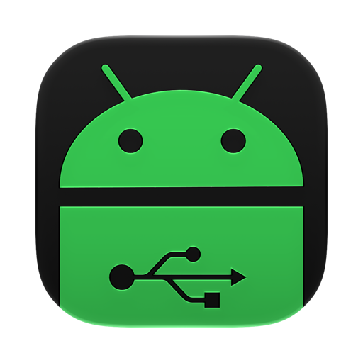
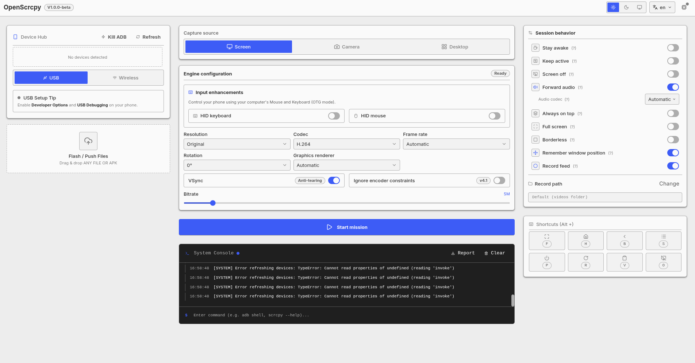
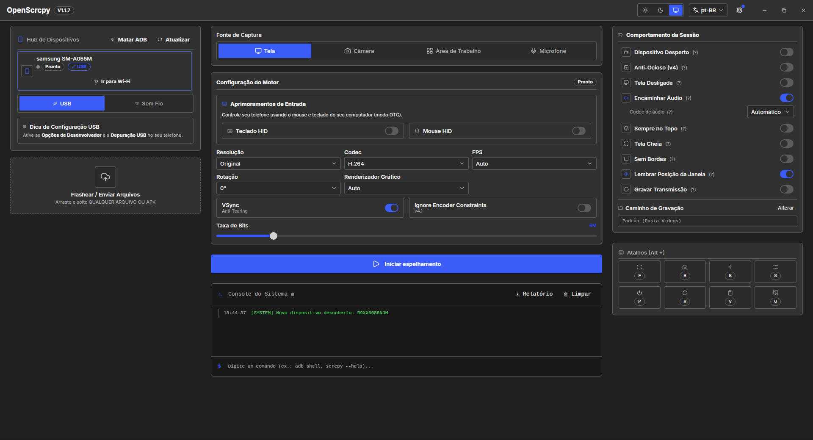

<div align="center">



# OpenScrcpy

**Control your Android from the desktop. Mirror the screen, use it as a webcam, or open a virtual display.**

`v2.0.0` · `MIT` · `Linux / Windows / macOS`

[](https://pt.liberapay.com/mryofc/)

</div>

---

## Screenshots

| Light | Dark |
| ----- | ---- |
|  |  |

---

## Features

- **Mirror, camera and desktop modes** — screen mirroring, phone-as-webcam with lens, torch and zoom controls, and a virtual display with flex resize.
- **Precision input over OTG/HID** — hardware keyboard and mouse simulation, side by side.
- **Wireless pairing with history** — pair Android 11+ devices over Wi-Fi and reconnect in one click.
- **One-click core setup** — automatic core binary download and update checks, right from the header.
- **Render driver selection** — capability-aware graphics backends, filtered by OS.
- **Drag and drop files** — drop an APK to install it, or push any file to `/sdcard/Download/`.
- **In-app update notices** — checks the GitHub releases and installs the signed update from inside the app.

---

## Installation

### Quick start

1. Download the latest release from [Releases](https://github.com/Umbr-Corp/OpenScrcpy/releases).
2. Enable **USB debugging** on your Android device (plus **Wireless debugging** for Wi-Fi connections).
3. Follow the full walkthrough in [GUIDE.md](GUIDE.md) or the [Wiki](https://github.com/Umbr-Corp/OpenScrcpy/wiki).

### NixOS (flakes)

To install it permanently with a desktop launcher, add the flake to your system's `flake.nix`:

```nix
inputs.openscrcpy.url = "git+https://github.com/Umbr-Corp/OpenScrcpy";
```

Then add it to your system packages:

```nix
environment.systemPackages = [
  inputs.openscrcpy.packages.${pkgs.system}.default
];
```

---

## Development

### Prerequisites

- Node.js 20.19+ or 22.12+ (Vite 8 requirement)
- The Rust toolchain and Cargo
- The desktop framework's OS-level prerequisites

### Build

1. `npm install`
2. `npm run tauri dev` — development
3. `npm run tauri build` — production

### Updates

The app updates through the Tauri updater plugin, which polls
`releases/latest/download/latest.json` on GitHub. `scripts/publish-release.mjs
manifest` rebuilds that asset from the published release assets: it maps each
platform to the signed artifact and uses the release body as the notes. An
empty body falls back to `Release v<version>` instead of the old placeholder.
The manifest is uploaded to the release itself, so the protected `main` branch
is never written by the release bot.

The app version must match in `package.json`, `src-tauri/tauri.conf.json`,
`src-tauri/Cargo.toml` and `src-tauri/Cargo.lock`.
`scripts/__tests__/version-consistency.test.ts` enforces it.
`updater/latest.json` is a local copy for inspection; the release workflow
rebuilds and uploads it after the tag.

---

## Security

The in-app console runs only the `adb` and `scrcpy` binaries resolved by the
app, not an arbitrary shell. It is meant for device and session commands.

Found a vulnerability? Read [SECURITY.md](SECURITY.md) — report it privately, never in a public issue.

## License

This project is licensed under the MIT License — see the [LICENSE](LICENSE) file for details.
