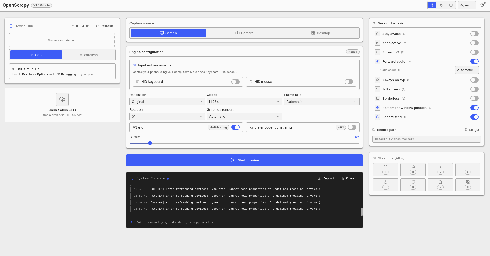
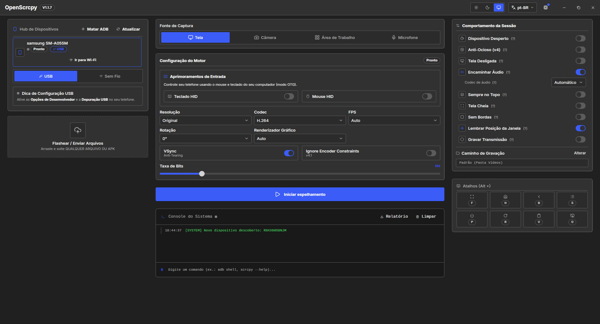

<p align="center">
  
  <br>
  <h1>OpenScrcpy</h1>
  <strong>Control your Android from the desktop. Mirror the screen, use it as a webcam, or open a virtual display.</strong>
  <br><br>
  <code>v1.0.0</code> · <code>MIT</code> · <code>Linux / Windows / macOS</code>
</p>

---

## Screenshots

| Light | Dark |
| ----- | ---- |
|  |  |

---

## Features

- Mirror, camera and desktop modes. Screen mirroring, phone-as-webcam with lens, torch and zoom controls, and a virtual display with flex resize.
- Precision input over OTG/HID. Hardware keyboard and mouse simulation, side by side.
- Wireless pairing with history. Pair Android 11+ devices over Wi-Fi and reconnect in one click.
- One-click core setup. Automatic core binary download and update checks, right from the header.
- Render driver selection. Capability-aware graphics backends, filtered by OS.
- Drag and drop files. Drop an APK to install it, or push any file to `/sdcard/Download/`.

---

## Quick start

1. Download the latest release from [Releases](https://github.com/Umbr-Corp/OpenScrcpy/releases).
2. Enable **USB debugging** on your Android device (plus **Wireless debugging** for Wi-Fi connections).
3. Follow the full walkthrough in [GUIDE.md](GUIDE.md) or the [Wiki](https://github.com/Umbr-Corp/OpenScrcpy/wiki).

---

## Development

### Prerequisites
- A JavaScript runtime (v18 or newer)
- The Rust toolchain and Cargo
- The desktop framework's OS-level prerequisites

### Build instructions
1. `npm install`
2. `npm run tauri dev` (Development)
3. `npm run tauri build` (Production)

## NixOS installation (flakes)

To install it permanently with a desktop launcher, add the flake to your system's `flake.nix`:

```nix
inputs.openscrcpy.url = "github:Umbr-Corp/OpenScrcpy";
```

Then add it to your system packages:

```nix
environment.systemPackages = [
  inputs.openscrcpy.packages.${pkgs.system}.default
];
```
---

## License

This project is licensed under the MIT License - see the [LICENSE](LICENSE) file for details.
